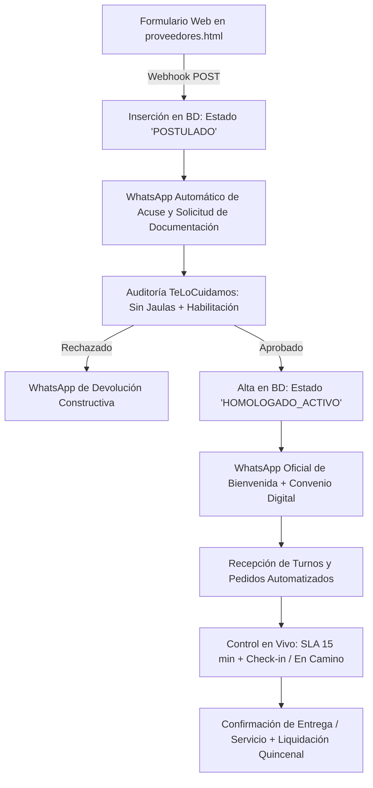
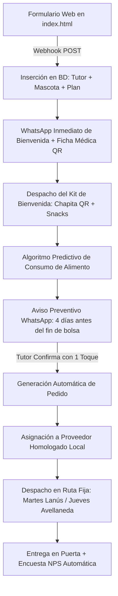

# Circuito Operativo Integral: Proveedores y Clientes (Tutores)
## TeLoCuidamos.com — Lanús y Avellaneda

Este documento establece la arquitectura de procesos, flujos automatizados de WhatsApp, reglas de negocio en base de datos y protocolos de supervisión en tiempo real para **Proveedores Homologados** y **Clientes (Tutores)** de TeLoCuidamos.

---

## 1. CIRCUITO INTEGRAL DE PROVEEDORES

El modelo de TeLoCuidamos se basa en una red curada de proveedores de máxima confianza bajo el estándar estricto **"Sin Jaulas ni Maltrato"**. A continuación se detalla el ciclo de vida completo del proveedor.



### 1.1. Registro y Captación Inicial
1. **Punto de Entrada:** El profesional, pet shop o cuidador completa el formulario en [`app/proveedores.html`](file:///C:/Users/Maranatha%202/Desktop/Te%20Lo%20Cuidamos/app/proveedores.html).
2. **Campos Recolectados:**
   - Nombre y Apellido / Razón Social.
   - WhatsApp de contacto directo.
   - Localidad y dirección exacta (Lanús Este/Oeste, Avellaneda Centro, Wilde, Gerli, etc.).
   - Rubro (`Veterinaria`, `Peluquería Canina / Grooming`, `Paseador`, `Hospedaje Familiar`, `Pet Shop / Distribuidor Alimentos`).
   - Matrícula profesional (si aplica).
   - Capacidad operativa o cupo diario.
   - Aceptación expresa de la política **"100% Sin Jaulas ni Sedación sin Criterio Médico"**.

### 1.2. WhatsApp de Confirmación Inmediata (Acuse de Recibo)
Apenas se procesa el formulario (menos de 3 segundos), el sistema dispara a través de WhatsApp Cloud API el siguiente mensaje oficial:

> **Mensaje de WhatsApp — Acuse de Recibo Proveedor:**
> 
> "¡Hola [Nombre]! 👋 Gracias por postularte para sumarte a la red de proveedores homologados de **TeLoCuidamos.com** en [Localidad].
> 
> Hemos generado tu solicitud con el **Legajo N° #PROV-[ID]**.
> 
> En TeLoCuidamos priorizamos el bienestar animal absoluto (política 100% Sin Jaulas y trato 1 a 1). En las próximas 24 a 48 hs hábiles, nuestro equipo de Calidad te contactará para:
> 1. Coordinar una breve videollamada o visita técnica a tus instalaciones / zona de paseo.
> 2. Validar tu documentación (matrícula profesional o referencias comprobables).
> 
> Si querés acelerar el proceso, podés responder a este mensaje adjuntando fotos de tu espacio de trabajo o tu constancia de matrícula.
> 
> ¡Un gran abrazo!  
> **Equipo de Calidad y Alianzas — TeLoCuidamos.com**  
> Lanús & Avellaneda"

### 1.3. Registro en Base de Datos (Estado Inicial)
El registro se inserta en la tabla `proveedores` con la siguiente estructura de auditoría:
```sql
INSERT INTO proveedores (
    codigo_legajo,
    nombre_titular,
    rubro,
    whatsapp,
    localidad,
    direccion,
    matricula,
    estado,
    scoring_calidad,
    politica_sin_jaulas_firmada,
    creado_en
) VALUES (
    'PROV-2026-089',
    'Dra. Mariana López',
    'VETERINARIA',
    '+5491140001122',
    'Lanus Oeste',
    'Hipólito Yrigoyen 4200',
    'MP-84920',
    'POSTULADO_EN_AUDITORIA',
    0.0,
    FALSE,
    NOW()
);
```

### 1.4. Proceso de Auditoría y Homologación
El equipo de operaciones ejecuta una auditoría de 3 pasos:
- **Paso 1: Validación de Credenciales.** Cotejo de matrícula en el Colegio de Veterinarios de la Pcia. de Buenos Aires (Distrito II) o referencias verificadas para cuidadores y paseadores.
- **Paso 2: Inspección Física o Videollamada Técnica.** Se constata que la peluquería o clínica no mantenga animales hacinados ni enjaulados, que cuenten con aire acondicionado/ventilación y medidas de escape cero.
- **Paso 3: Scoring y Firma de Convenio.** Se define el scoring inicial (escala 1 al 10) y el esquema de comisión acordado (18% a 22% según rubro).

### 1.5. Alta Oficial de Proveedor (Aprobación)
Una vez aprobado, el estado pasa a `HOMOLOGADO_ACTIVO` y se le envía el kit digital de bienvenida:

> **Mensaje de WhatsApp — Alta y Activación de Proveedor:**
> 
> "🎉 ¡Felicitaciones, [Nombre]! Tu cuenta como Proveedor Homologado de **TeLoCuidamos.com** ha sido **APROBADA**.
> 
> Ya estás habilitado para recibir turnos y pedidos en tu zona ([Localidad]).
> 
> 📋 **Tu Credencial Digital:**
> - Legajo: `PROV-[ID]`
> - Rubro: [Rubro]
> - Comisión pactada: [18% / 20% / 22%]
> - Cierre de liquidaciones: Quincenal (días 15 y 30 de cada mes por transferencia bancaria).
> 
> 📲 **¿Cómo recibirás los pedidos?**
> Cada vez que un tutor de tu zona reserve un servicio o solicite un alimento, recibirás un mensaje interactivo con los datos del paciente y botones para [Aceptar] o [Reprogramar].
> 
> ¡Bienvenido a la red que transforma el cuidado animal en Zona Sur!"

### 1.6. Cómo le Llegan los Pedidos al Proveedor
Cuando el sistema genera una orden de alimento o una reserva de turno, el bot envía un mensaje interactivo directo al WhatsApp del proveedor asignado:

> **Mensaje de WhatsApp — Nuevo Pedido / Turno Asignado:**
> 
> "📦 **NUEVO PEDIDO ASIGNADO — Orden #[ORDEN_ID]**
> 
> 🐶 **Paciente / Mascota:** Milo (Golden Retriever, 3 años, 28 kg)  
> 👤 **Tutor:** Carlos Gómez ([WhatsApp])  
> 📍 **Entrega / Ubicación:** Av. Mitre 1250, Avellaneda Centro  
> 📋 **Detalle:** 1x Royal Canin Maxi Adult 15kg  
> ⏰ **Fecha y Franja:** Jueves de 14:00 a 18:00 hs (Ruta Avellaneda)  
> 💵 **Monto a liquidar al proveedor:** $39.360 ARS (Neto acordado)
> 
> 👉 Por favor, confirmá la disponibilidad de stock y preparación dentro de los próximos 15 minutos:
> 
> `[ BOTÓN: ✅ Confirmar Stock y Preparación ]`  
> `[ BOTÓN: ⚠️ Sin Stock / Reasignar ]`"

### 1.7. Control de Estado y Seguimiento en Tiempo Real
1. **SLA de Respuesta:** El proveedor tiene **15 minutos** para presionar `[Confirmar]`. Si no responde, el sistema escala un alerta al supervisor de guardia y dispara reasignación automática al proveedor secundario más cercano.
2. **Control "En Camino":**
   - Para alimentos: El proveedor notifica cuando la bolsa está rotulada con la etiqueta QR de TeLoCuidamos (`Orden lista para despacho`).
   - El cadete asignado en la ruta fija (Martes Lanús / Jueves Avellaneda) escanea el QR con su celular. En ese instante, el sistema cambia el estado a `EN_CAMINO_CADETE` y envía un WhatsApp al cliente con el enlace de seguimiento en vivo.
   - Al llegar al domicilio, el cadete toma una fotografía de la entrega o solicita la firma digital del tutor.
   - El estado pasa a `ENTREGADO_EXITOSO`, cerrando la trazabilidad.

---

## 2. CIRCUITO INTEGRAL DE CLIENTES (TUTORES)

El tutor experimenta una atención hiperpersonalizada y preventiva, diseñada para que nunca más tenga que acordarse de comprar alimento ni preocuparse por la seguridad de su mascota.



### 2.1. Registro de Mascota y Tutor
1. **Punto de Entrada:** Formulario en [`app/index.html`](file:///C:/Users/Maranatha%202/Desktop/Te%20Lo%20Cuidamos/app/index.html).
2. **Datos Recogidos:**
   - Nombre del tutor y WhatsApp.
   - Barrio (Lanús Este/Oeste, Valentín Alsina, Avellaneda Centro, Sarandí, Wilde, etc.).
   - Nombre de la mascota, especie, raza, edad y peso estimado.
   - Marca y variedad de alimento balanceado que consume actualmente.
   - Servicios de interés recurrente (Veterinaria preventiva, Peluquería sin jaulas, Paseos, Guardería).

### 2.2. WhatsApp Inmediato de Bienvenida
A los 5 segundos del registro, el tutor recibe:

> **Mensaje de WhatsApp — Bienvenida Personalizada:**
> 
> "¡Hola [Nombre Tutor]! 🐾 Qué alegría darles la bienvenida a vos y a **[Nombre Mascota]** a la familia de **TeLoCuidamos.com**.
> 
> Te confirmamos que [Nombre Mascota] ya tiene activa su **Ficha Médica Digital** y legajo N° #MAS-[ID].
> 
> 🎁 **Tu Kit de Bienvenida sin cargo:**  
> En tu primer pedido programado de alimento o servicio en [Localidad], te entregamos:
> 1. Chapita identificatoria inteligente con código QR vinculado a su historia clínica y tu WhatsApp.
> 2. Guía de nutrición preventiva avalada por veterinarios de Zona Sur.
> 
> 🤖 **Tranquilidad Total:**  
> A partir de ahora, calculamos cuándo se le terminará la comida a [Nombre Mascota] y te avisaremos 4 días antes para coordinar el envío a domicilio sin que tengas que pedirlo.
> 
> ¿Querés programar tu primera entrega para este próximo [Martes en Lanús / Jueves en Avellaneda]?
> 
> `[ BOTÓN: ✅ Sí, coordinar primera entrega ]`  
> `[ BOTÓN: 💬 Hablar con una veterinaria ]`"

### 2.3. Registro en Base de Datos (Relaciones)
El motor relacional almacena el vínculo completo:
```sql
-- 1. Insertar Tutor
INSERT INTO tutores (nombre, whatsapp, email, direccion, localidad, zona_reparto)
VALUES ('Carlos Gómez', '+5491155554444', 'carlos@gmail.com', 'Av. Mitre 1250', 'Avellaneda', 'JUEVES_AVELLANEDA');

-- 2. Insertar Mascota
INSERT INTO mascotas (tutor_id, nombre, especie, raza, peso_kg, fecha_nacimiento, qr_token)
VALUES (104, 'Milo', 'PERRO', 'Golden Retriever', 28.5, '2023-04-10', 'QR-MILO-8472');

-- 3. Insertar Plan de Alimento Predictivo
INSERT INTO planes_alimento (
    mascota_id,
    marca_alimento,
    presentacion_kg,
    gramos_diarios_estimados,
    duracion_dias_bolsa,
    fecha_ultimo_pedido,
    fecha_estimada_agotamiento,
    fecha_aviso_preventivo
) VALUES (
    302,
    'Royal Canin Maxi Adult',
    15.0,
    375,  -- 28.5 kg * ~13.1 g/kg
    40,   -- 15.000 g / 375 g/dia = 40 dias
    '2026-10-28',
    '2026-12-07',
    '2026-12-03'  -- 4 días antes
);
```

### 2.4. Automatización Predictiva: Aviso 4 Días Antes
Cuatro días antes de la fecha estimada de finalización de la bolsa (`fecha_aviso_preventivo`), el cron job diario (`cron_predictor_alimento.py`) envía automáticamente el recordatorio interactivo:

> **Mensaje de WhatsApp — Aviso Predictivo de Reposición:**
> 
> "¡Hola [Nombre Tutor]! 🐾  
> Según nuestro registro, a **[Nombre Mascota]** le quedan aproximadamente **4 días de comida** ([Marca Alimento] [Kg]kg).
> 
> Tenemos ruta de entrega programada en **[Localidad]** para este **[Martes / Jueves]** entre las 13:00 y las 18:00 hs.
> 
> 📦 **Tu pedido sugerido:**
> - 1x [Marca Alimento] [Kg]kg
> - Envío a domicilio en puerta bonificado
> - Total: $[Precio] ARS
> 
> Para confirmar la entrega con 1 solo toque elegí una opción:
> 
> `[ BOTÓN: ✅ Confirmar entrega este [Día] ]`  
> `[ BOTÓN: 📅 Cambiar día / bolsa más chica ]`  
> `[ BOTÓN: ⏸️ Todavía tengo alimento ]`"

### 2.5. Aseguramiento de Respuesta y Asignación al Proveedor
1. **Confirmación con 1 Toque:** Al presionar `[Confirmar entrega]`, el webhook de WhatsApp dispara la creación de la orden en estado `ASIGNADA_A_PROVEEDOR`.
2. **Selección del Proveedor:** El sistema busca en la base de datos el proveedor oficial que posea el producto en inventario y esté ubicado a menor distancia del domicilio del tutor (ej. Pet Shop homologado en Avellaneda Centro).
3. **Control de Compromiso:** El proveedor tiene 15 minutos para aceptar. Si no acepta en 15 minutos, salta un ping automático por SMS y se reasigna a la central de distribución secundaria de respaldo.

### 2.6. Control de Despacho y Entrega en Puerta
1. **Día de Entrega (Ruta Fija):**
   - **Martes:** Lanús Oeste, Lanús Este, Remedios de Escalada, Valentín Alsina, Gerli Oeste.
   - **Jueves:** Avellaneda Centro, Crucesita, Sarandí, Villa Domínico, Wilde, Gerli Este.
2. **Notificación Matutina:**
   > "¡Buen día [Tutor]! Tu pedido para [Mascota] está en el furgón de reparto de hoy. El cadete [Nombre Cadete] estará pasando por tu domicilio entre las [Hora Inicio] y las [Hora Fin] hs. Seguí el recorrido en vivo aquí: `https://telocuidamos.com/rastreo?token=TRK-[ID]`"
3. **Confirmación de Entrega:**
   - El cadete escanea la chapita o entrega el bulto y confirma en la web-app de cadetería.
   - Al completarse, se dispara la encuesta de satisfacción (NPS de 1 a 5 estrellas) por WhatsApp 2 horas después.

---

## 3. TABLA COMPARATIVA DE SLAS Y CONTROL OPERATIVO

| Evento / Punto de Control | Responsable | Canal / Herramienta | SLA Máximo | Acción de Contingencia ante Fallo |
| :--- | :--- | :--- | :--- | :--- |
| **Postulación de Proveedor** | Sistema / Webhook | WhatsApp Cloud API | < 5 segundos | Notificación por email a operaciones |
| **Auditoría "Sin Jaulas"** | Equipo de Calidad | Visita / Videollamada | 48 horas hábiles | Recordatorio automático a supervisor |
| **Aviso Predictivo Tutor** | Cron Job Predictor | WhatsApp Interactivo | 4 días antes del fin | Fallback a mensaje estándar si no responde botón |
| **Aceptación de Pedido por Proveedor** | Proveedor Homologado | WhatsApp Bot | 15 minutos | Reasignación automática a proveedor secundario |
| **Despacho en Ruta** | Cadetería Homologada | Web-App de Reparto | Día fijo (Mar/Jue) | Aviso por WhatsApp al cliente de reprogramación |
| **Resolución de Quejas / Incidentes** | Guardia Veterinaria 24hs | Teléfono / WhatsApp VIP | < 5 minutos | Protocolo de traslado veterinario de urgencia |

---

*Documento aprobado por Dirección Operativa y Calidad — TeLoCuidamos.com.*
