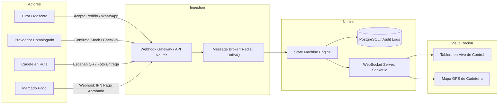
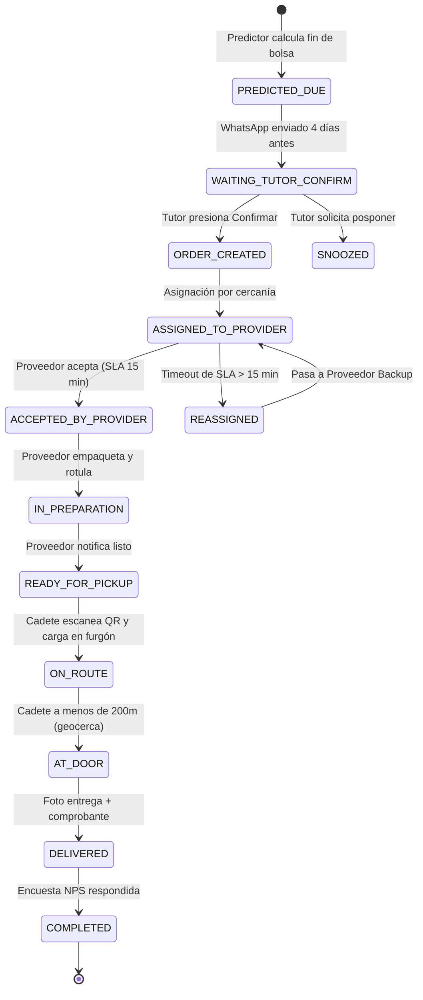

# Sistema de Trazabilidad en Tiempo Real y Arquitectura de Eventos
## TeLoCuidamos.com — Pipeline de Seguimiento Operativo

Este documento describe la arquitectura tecnológica, el ciclo de vida de estados (*State Machine*), los eventos de telemetría y los mecanismos de monitoreo continuo para garantizar trazabilidad de extremo a extremo en cada pedido de alimento y turno de servicio.

---

## 1. ARQUITECTURA GENERAL DEL SISTEMA DE TRAZABILIDAD

El sistema opera bajo un patrón **Event-Driven Architecture (EDA)** desacoplado, donde cada interacción de tutores, proveedores, pasarelas de pago y cadetes emite un evento estructurado que alimenta el tablero en vivo y la base de datos de auditoría.



---

## 2. MÁQUINA DE ESTADOS FINITOS (STATE MACHINE)

Cada orden sigue una máquina de estados estricta y verificable con sellos de tiempo (*timestamps* ISO 8601) y firma del operador/agente:



### Tabla de Estados y Códigos Operativos

| Código de Estado | Descripción Operativa | Disparador (Trigger) | SLA Máximo | Alerta si se supera |
| :--- | :--- | :--- | :--- | :--- |
| `PRED_AVISO_ENVIADO` | WhatsApp preventivo enviado al tutor | Cron job 09:00 AM | 48 horas | Reintento automático con mensaje alternativo |
| `ORDEN_GENERADA` | Tutor confirmó reposición de alimento | Webhook WhatsApp `btn_confirmar` | Inmediato | Alerta técnica si falla inserción en BD |
| `ASIGNADA_PROV` | Pedido transferido al WhatsApp del proveedor | Algoritmo de cercanía | 15 minutos | **ALERTA ROJA:** Reasignación a proveedor backup |
| `ACEPTADA_PROV` | Proveedor confirmó stock y preparación | Webhook WhatsApp proveedor | 3 horas | Alerta a supervisor de abastecimiento |
| `LISTO_DESPACHO` | Bolsa rotulada con QR lista para retiro | Proveedor presiona `[Listo]` | 24 horas | Notificación a cadetería de zona |
| `EN_CAMINO_CADETE`| Cadete escaneó QR de paquete al subir al furgón | App cadete (cámara QR) | 4 horas (en ventana) | Aviso al cliente con tracking URL en vivo |
| `ENTREGADO_OK` | Paquete entregado al tutor en domicilio | Foto en puerta + firma | Inmediato | Notificación de éxito al tutor |
| `CERRADO_LIQUIDADO`| Transacción liquidada al proveedor quincenalmente | Proceso contable quincenal | Quincenal | Conciliación bancaria |

---

## 3. ESQUEMA DE EVENTOS Y REGISTRO DE AUDITORÍA (AUDIT LOG)

Cada cambio de estado genera un registro inmutable en la tabla `order_events`:

```sql
CREATE TABLE order_events (
    id BIGSERIAL PRIMARY KEY,
    order_id VARCHAR(30) NOT NULL,
    estado_anterior VARCHAR(50),
    estado_nuevo VARCHAR(50) NOT NULL,
    actor_tipo VARCHAR(30) NOT NULL, -- 'SYSTEM', 'TUTOR', 'PROVEEDOR', 'CADETE'
    actor_id VARCHAR(50) NOT NULL,
    coordenadas_gps VARCHAR(50),      -- Latitud / Longitud si aplica
    payload_json JSONB,              -- Datos adicionales (foto URL, motivo, etc.)
    timestamp TIMESTAMP WITH TIME ZONE DEFAULT NOW()
);
```

### Ejemplo de Payload de Evento en Vivo (JSON)
```json
{
  "event_id": "evt_98327491",
  "order_id": "TLC-2026-0492",
  "timestamp": "2026-10-28T14:32:10-03:00",
  "estado": "EN_CAMINO_CADETE",
  "localidad": "Lanus Este",
  "tutor": {
    "nombre": "Florencia Rossi",
    "mascota": "Simón",
    "direccion": "Anatole France 1820"
  },
  "proveedor": {
    "legajo": "PROV-2026-014",
    "nombre": "Pet Shop Patitas Lanús"
  },
  "cadete": {
    "nombre": "Mariano Ruiz",
    "vehiculo": "Moto Honda GLH 150 / Caja Térmica"
  },
  "tracking_url": "https://telocuidamos.com/rastreo?token=TRK-9832",
  "sla_minutos_transcurridos": 42
}
```

---

## 4. DASHBOARD DE CONTROL EN TIEMPO REAL

Para monitorear todas las operaciones de Lanús y Avellaneda simultáneamente, el equipo de operaciones cuenta con el **Tablero de Trazabilidad en Vivo** ([`app/trazabilidad.html`](file:///C:/Users/Maranatha%202/Desktop/Te%20Lo%20Cuidamos/app/trazabilidad.html)), el cual provee:
1. **Métricas en Vivo (KPIs):**
   - Órdenes Activas Hoy.
   - En Preparación en Proveedores.
   - En Reparto en Calle (Cadetes activos).
   - Entregadas con Éxito.
   - Tasa de Cumplimiento de SLA Proveedores (% respondido en < 15 min).
2. **Pipeline Visual Kanban / Colunas de Estado:**
   - Visualización instantánea de cada pedido arrastrable y actualizable en tiempo real.
3. **Consola de Eventos en Tiempo Real (Live Event Log):**
   - Feed tipo terminal con cada mensaje emitido por WhatsApp, escaneo QR y cambio de estado con filtros por barrio.
4. **Filtro Hiperlocal:**
   - Selector entre `Todos`, `Lanús Centro / Este / Oeste / Escalada` y `Avellaneda Centro / Sarandí / Wilde`.

---

*Especificación técnica elaborada para TeLoCuidamos.com — Operaciones Buenos Aires Sur.*
